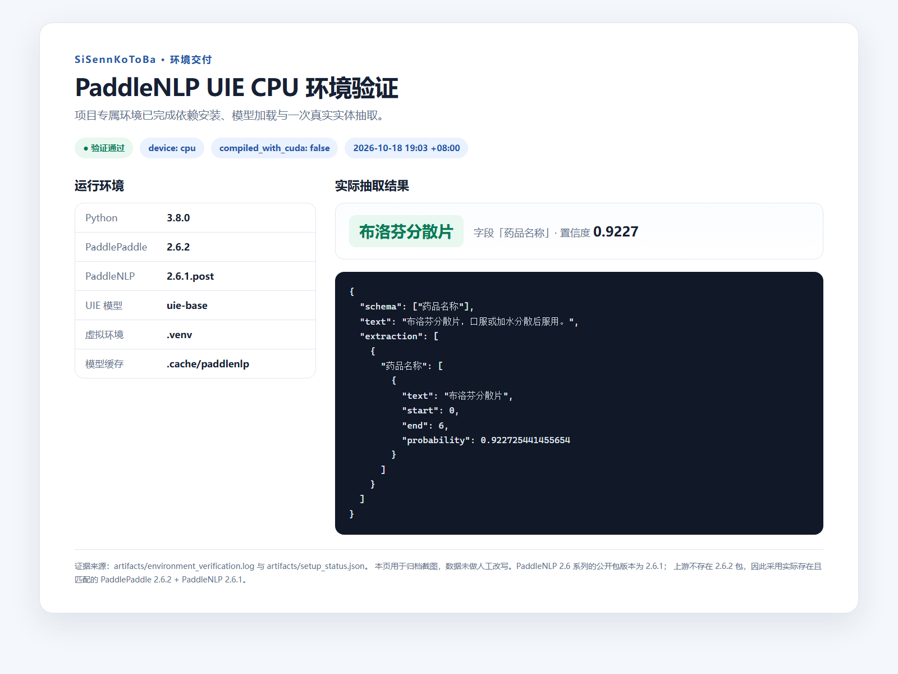

# Environment

## 交付结论

项目专属 CPU 环境已完成，且通过了真实的 Taskflow/UIE 推理验证。环境位于 `D:\SiSennKoToBa\.venv`，模型缓存位于 `D:\SiSennKoToBa\.cache\paddlenlp`，不会污染系统 Python。



## 实际版本

| 组件 | 实际版本 | 说明 |
|---|---:|---|
| Python | 3.8.0 | 本机没有 Conda；Python 3.8 有可用的 Paddle 2.6 Windows 轮子 |
| PaddlePaddle | 2.6.2 | CPU 版，`paddle.is_compiled_with_cuda() == false` |
| PaddleNLP | 2.6.1（模块显示 `2.6.1.post`） | pip 元数据版本为 2.6.1 |
| UIE 模型 | `uie-base` | 12 层、768 隐藏维度 |
| 模型缓存 | `.cache/paddlenlp` | 约 941,593,657 字节（898 MiB） |

### 版本偏离说明

原计划写的 `paddlepaddle==2.6.0 + paddlenlp==2.6.2` 无法按原样安装：

1. 清华 PyPI 镜像在此 Windows/Python 3.8 环境没有 `paddlepaddle==2.6.0` 轮子，实际可用的是 2.6.2。
2. PaddleNLP 的公开 2.6 系列版本是 2.6.0、2.6.1，随后为 2.7.0；不存在 2.6.2 包。
3. PaddleNLP `develop` 分支 README 已要求 PaddlePaddle 3.0.0rc1 和 PaddleNLP 3.0.0b4，但经典 Taskflow/UIE 示例对应 2.6 系列。因此本项目固定源码到 `v2.6.1`，没有把 3.0 的 develop 示例与 2.6 的 Python 包混用。

最终采用实际存在、且同属 2.6 系列的组合：**PaddlePaddle 2.6.2 + PaddleNLP 2.6.1**。

## 安装记录

机器上没有 Conda，因此用已有的 Python 3.8 创建项目级 venv：

```powershell
Set-Location 'D:\SiSennKoToBa'
D:\python3.8.0\python.exe -m venv .venv
.\.venv\Scripts\python.exe -m pip install --upgrade "pip==24.0" "setuptools==69.5.1" wheel -i https://pypi.tuna.tsinghua.edu.cn/simple
.\.venv\Scripts\python.exe -m pip install "paddlepaddle==2.6.2" -i https://pypi.tuna.tsinghua.edu.cn/simple
.\.venv\Scripts\python.exe -m pip install "paddlenlp==2.6.1" -i https://pypi.tuna.tsinghua.edu.cn/simple
.\.venv\Scripts\python.exe -m pip install "chardet==5.2.0" -i https://pypi.tuna.tsinghua.edu.cn/simple
```

已安装依赖也可通过项目根目录的 `requirements.txt` 复现。

创建和安装脚本：

- `scripts/setup_environment.ps1`
- `scripts/complete_setup.ps1`
- `scripts/finalize_environment.ps1`

## 激活与运行

```powershell
Set-Location 'D:\SiSennKoToBa'
.\.venv\Scripts\Activate.ps1
python -B .\scripts\verify_environment.py
```

也可以不激活，直接运行：

```powershell
.\.venv\Scripts\python.exe -B .\scripts\verify_environment.py
```

验证脚本会自动把 `PPNLP_HOME` 指向项目内的 `.cache/paddlenlp`。`PPNLP_HOME` 是 PaddleNLP 2.6.1 实际读取的模型根目录变量，确保后续模型与数据留在项目内。

## 验证结果

输入：

```text
布洛芬分散片，口服或加水分散后服用。
```

schema：

```python
["药品名称"]
```

实际输出：

```json
{
  "text": "布洛芬分散片",
  "start": 0,
  "end": 6,
  "probability": 0.922725441455654
}
```

证据文件：

- `artifacts/environment_verification.log`
- `artifacts/installed_versions.json`
- `artifacts/setup_status.json`
- `artifacts/environment_verification.png`

运行时会出现 `distutils`、`max_seq_len`、`pad_to_max_length` 的弃用警告，不影响本次 CPU 推理。

## 源码仓库

| 项目 | 本地位置 | 版本 |
|---|---|---|
| PaddleNLP | `third_party/PaddleNLP` | tag `v2.6.1`，commit `fd2bed541ff929f6f8b350001694e553b29d4e9a` |
| Information-Extraction-Chinese | `third_party/Information-Extraction-Chinese` | GitHub `master` 分支 ZIP 快照 |

本机 Git 2.19 在克隆第二个仓库时出现子进程不退出，因此 crownpku 仓库改用 GitHub ZIP 获取；内容已核对，包含完整的 `NER_IDCNN_CRF`、`RE_BGRU_2ATT` 与数据文件。

## 边界

- 当前安装是 CPU 版，不能用于 GPU 训练。
- 不建议直接 `pip install --upgrade paddlenlp`，否则会破坏已验证的 2.6 组合。
- 后续若要尝试 PaddleNLP 3.0/PP-UIE，应另建环境，不要覆盖本项目 `.venv`。
