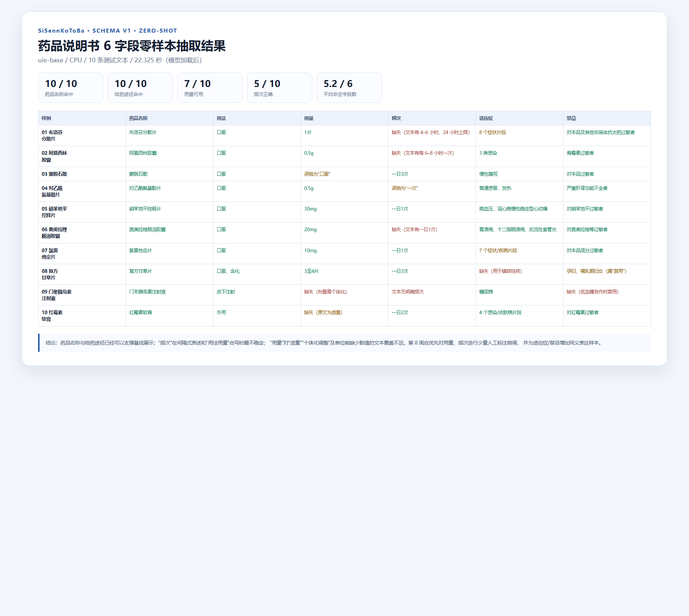

# Schema v1

## 1. 版本定义

任务：药品说明书字段抽取  
模型：`uie-base`  
设备：CPU  
schema：

```python
schema = ["药品名称", "用法", "用量", "频次", "适应症", "禁忌"]
```

只做实体抽取，不使用“主体-关系-客体”的嵌套 schema。

## 2. 字段定义

| 字段 | 定义 | 正例 | 0-shot 预期 |
|---|---|---|---|
| 药品名称 | 说明书对应的完整产品名，不截断剂型或限定词 | 布洛芬分散片 | 高 |
| 用法 | 给药途径或给药方式，如口服、外用、皮下注射、含化 | 口服、外用 | 高 |
| 用量 | 单次剂量及其单位；不把“一日几次”并入用量 | 0.5g、1片、30mg | 中 |
| 频次 | 每日次数或给药间隔 | 一日3次、每6至8小时一次 | 中 |
| 适应症 | 疾病、症状或治疗用途 | 高血压、发热、慢性腹泻 | 低到中 |
| 禁忌 | 明确禁止使用的人群、疾病状态或过敏条件 | 青霉素过敏者、严重肝肾功能不全者 | 低到中 |

设计原则：

- 先窄后宽，第一版只保留 6 个字段。
- 字段名使用中文且语义单一，避免“用法”同时承担途径和频次。
- 接受一个字段对应多个 span；例如适应症可能包含多个疾病。

## 3. 测试集

测试文本位于 `data/drug_label_samples_v1.json`，共 10 条，覆盖：

- 口服片剂、胶囊、散剂、控释片、肠溶胶囊。
- 外用软膏和皮下注射。
- 固定剂量、范围剂量、个体化剂量、“适量”等表达。
- 明确过敏禁忌、肝肾功能禁忌和孕期禁忌。

## 4. 零样本结果



汇总：

| 字段 | 人工核查结果 | 观察 |
|---|---:|---|
| 药品名称 | 10/10 | 稳定，置信度约 0.97–0.99 |
| 用法（途径） | 10/10 | 口服、外用、皮下注射、含化均能抽到 |
| 用量 | 7/10 | 缺少“适量/个体化”表达；1 条误抽为“口服” |
| 频次 | 5/10 | 间隔式表达和“用法用量”合写时最不稳定 |
| 适应症 | 9/10 | 多数能命中，但常拆成多个细粒度症状 |
| 禁忌 | 8/10 完整，1 条部分，1 条缺失 | 过敏和肝肾功能禁忌较稳定 |

统计：

- 10 条文本的平均非空字段数：5.2/6。
- 模型加载后的抽取耗时：22.325 秒。
- 总调用次数：10 条 × 6 字段。

原始结果与运行记录：

- `artifacts/schema_v1_zero_shot.json`
- `artifacts/schema_v1_run.log`
- `artifacts/schema_v1_results.png`

## 5. 误差分析

### 用量

- `蒙脱石散`：原文为“一次1袋”，模型却抽成“口服”，说明“用法用量”合写时发生字段污染。
- `门冬胰岛素注射液`：原文是“剂量应根据血糖水平个体化调整”，没有固定数值，模型返回空。
- `红霉素软膏`：原文为“取适量”，模型返回空。该字段更适合定义为“剂量描述”，允许“适量”等非数值表达。

### 频次

- `布洛芬分散片` 和 `阿莫西林胶囊` 使用“间隔 4–6 小时”“每 6–8 小时一次”表达，模型未抽出。
- `奥美拉唑肠溶胶囊` 的“一日1次”被漏掉。
- `对乙酰氨基酚片` 返回“一次”，把剂量单位片段误当频次。

### 适应症与禁忌

- 适应症经常被拆成多个细粒度症状片段，例如“头痛、牙痛、肌肉痛”。这不一定错，但需要统一评测粒度。
- `复方甘草片` 的“孕妇、哺乳期妇女”被抽到，但漏掉“禁用”；禁忌字段应定义为“禁忌对象或限制条件”，允许只返回对象，同时另设状态字段的讨论留到后续。
- `门冬胰岛素注射液` 的“低血糖发作时禁用”未抽出，说明条件式禁忌仍是弱点。

## 6. 第 8 周建议

1. 保持“药品名称、用法、适应症”作为首版主展示字段。
2. 将“用量”定义细化为“单次剂量或剂量描述”，为“适量、个体化调整”补标注。
3. 将“频次”统一写成“每日次数或给药间隔”，对比原 schema 与细化措辞。
4. 优先给用量、频次各准备少量高质量标注样本，先验证微调收益，再扩大字段。
5. 第 8 周把测试集扩到 20 条以上；本轮 10 条只用于方向判断。
